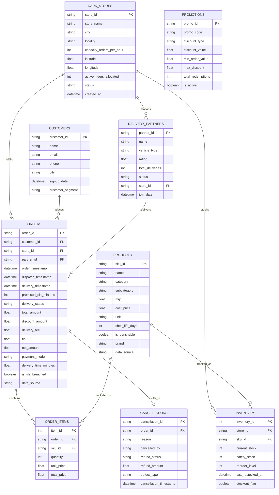

# QuickCommerce Intelligence - Database Entity Relationship (ER) Schema

## Architecture Diagram (Mermaid)

## Relational Entity Specifications

| Table Name | Description | Key Business Attributes |
|---|---|---|
| `dark_stores` | Micro-fulfillment dark stores situated within high-density urban catchments. | Store capacity, rider pool allocation, GPS coordinates. |
| `products` | FMCG and grocery product catalog benchmarking Indian retail brands. | Shelf-life, perishability flag, MRP, wholesale cost price. |
| `customers` | Quick commerce consumers segmented by order frequency. | RFM segments, city location, account registration date. |
| `delivery_partners` | Gig delivery riders fulfilling 15-minute quick delivery runs. | Vehicle type (EV / Petrol), customer rating, speed track. |
| `orders` | Transactional master record tracking promised vs actual fulfillment SLAs. | Dispatch timestamp, delivery duration, discount burn, payment method. |
| `order_items` | Line items associated with each customer basket. | Unit sell price, SKU identifier, order quantity. |
| `inventory` | Dark store shelf stock monitoring real-time stockouts. | Safety threshold, reorder trigger point, stockout flag. |
| `promotions` | Campaign discount vouchers and subsidies. | Minimum order value (MOV), discount caps, redemption counts. |
| `cancellations` | Aborted orders, operational defects, and customer refunds. | Cancellation initiator, refund liability, defect category. |
